<div align="center">

<a href="https://github.com/DUBSOpenHub?tab=repositories"></a>


<a href="https://github.com/DUBSOpenHub/copilot-first-light"></a><a href="https://github.com/DUBSOpenHub/dark-factory"></a><a href="https://github.com/DUBSOpenHub/terminal-stampede"></a><a href="https://github.com/DUBSOpenHub/havoc-hackathon"></a>

<details>
<summary><b>Copy the install commands</b></summary>
<br>

<div align="left">

```bash
# FIRST LIGHT: Build your first AI agent with GitHub Copilot
curl -fsSL https://raw.githubusercontent.com/DUBSOpenHub/copilot-first-light/main/install.sh | bash

# DARK FACTORY: Run inside GitHub Copilot CLI
/skills add DUBSOpenHub/dark-factory

# TERMINAL STAMPEDE: Run up to 20 AI coding agents in tmux panes
curl -fsSL https://raw.githubusercontent.com/DUBSOpenHub/terminal-stampede/main/quickstart.sh | bash

# HAVOC HACKATHON: Run inside GitHub Copilot CLI
/skills add DUBSOpenHub/havoc-hackathon
```

</div>

</details>

<br>


<a href="https://github.com/DUBSOpenHub/looper"></a>
<a href="https://github.com/DUBSOpenHub/copilot-skills"></a>
<a href="https://github.com/DUBSOpenHub/havoc-hackathon"></a>
<a href="https://github.com/DUBSOpenHub/dark-factory"></a>
<a href="https://github.com/DUBSOpenHub/shadow-score-spec"></a>

<br>


<br>

<sub>Built in the open with GitHub Copilot · Updated 2026-11-04 · <a href="https://github.com/DUBSOpenHub?tab=repositories">All 37 projects →</a></sub>

</div>
